<p align="center">
  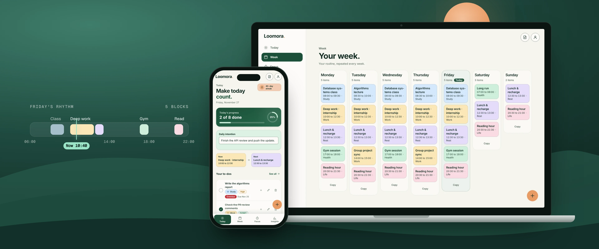
</p>

<h1 align="center">Loomora</h1>

<p align="center"><strong>Plan your day, focus on it, and see how it really went.</strong></p>

<p align="center">
  <a href="https://loomora-craft.vercel.app/"></a>
  <a href="https://loomora-api.onrender.com/docs"></a>
</p>

<p align="center">
  
  
  
  
  
  
  
</p>

---

Most planners make you choose between a task list and a calendar. **Loomora puts your to-dos and your weekly routine on one Today screen**, gives you a calm focus timer, and shows how the week really went. Start right away as a guest, no sign-up needed. Your plan moves to an account when you sign up.

> **Branches.** The current app lives on [`v2-rebuild`](https://github.com/danishsary8/Loomora_front/tree/v2-rebuild) (deployed to the live demo). `main` keeps the original version and the [portfolio kit](portfolio/).

## ✨ Highlights

<table>
  <tr>
    <td width="33%" valign="top">
      <h3>🗓️ Plan</h3>
      To-dos with categories, priority, subtasks, repeats and reminders, next to a fixed weekly schedule. A Now / Next card shows where you are in the day.
    </td>
    <td width="33%" valign="top">
      <h3>⏱️ Focus</h3>
      A countdown (25, 50, 90 min or custom) or a stopwatch, linked to a to-do or a schedule block. It keeps running across pages and reloads.
    </td>
    <td width="33%" valign="top">
      <h3>📈 Review</h3>
      Insights for the week: completion, focus time, streak, completion rhythm and Plan vs reality. Plus coloured, pinned and tagged notes.
    </td>
  </tr>
</table>

## 📱 The app

<table>
  <tr>
    <th>Today</th>
    <th>Week</th>
    <th>Focus</th>
    <th>Insights</th>
  </tr>
  <tr>
    <td>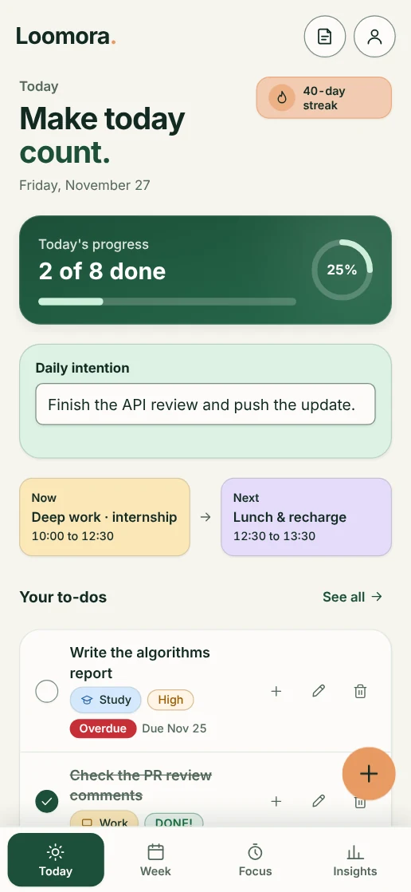</td>
    <td>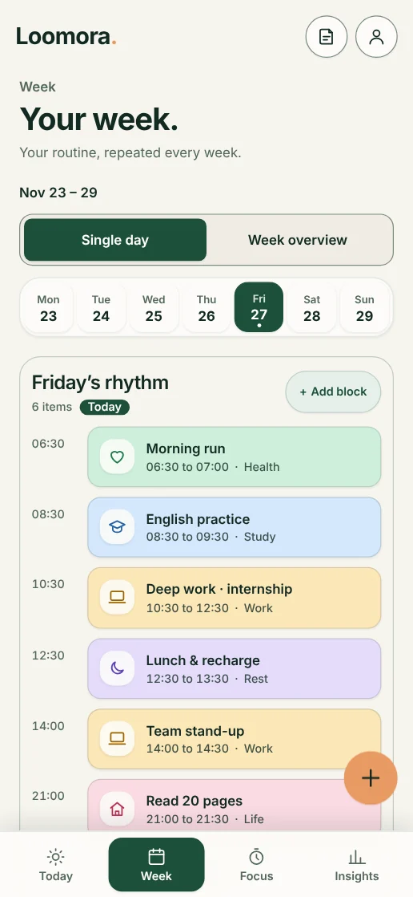</td>
    <td>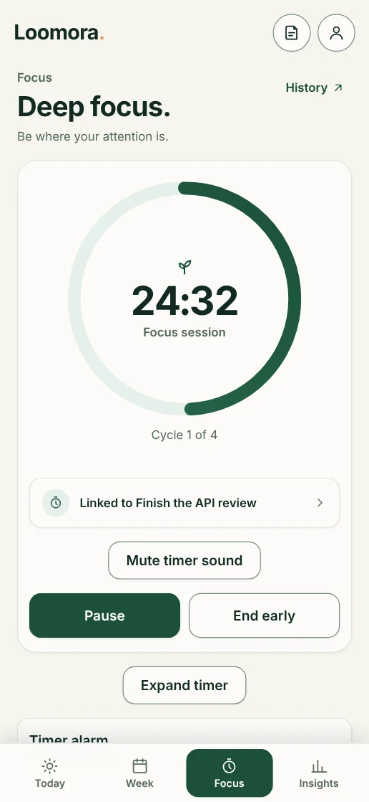</td>
    <td>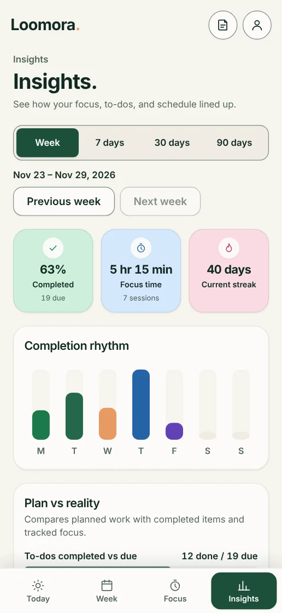</td>
  </tr>
  <tr>
    <th>Add a to-do</th>
    <th>Notes</th>
    <th>Profile</th>
    <th>Sign up</th>
  </tr>
  <tr>
    <td>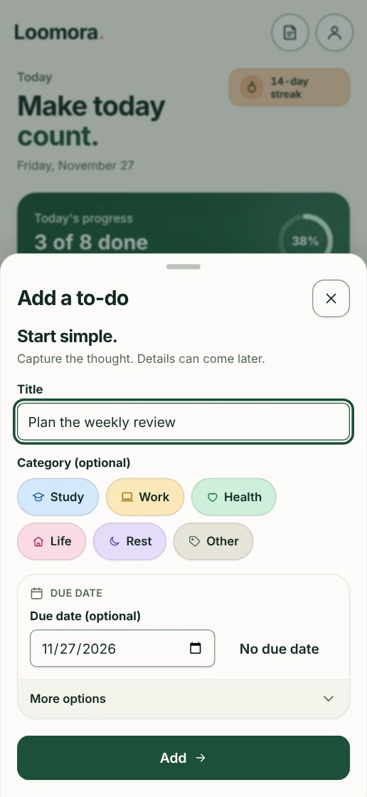</td>
    <td>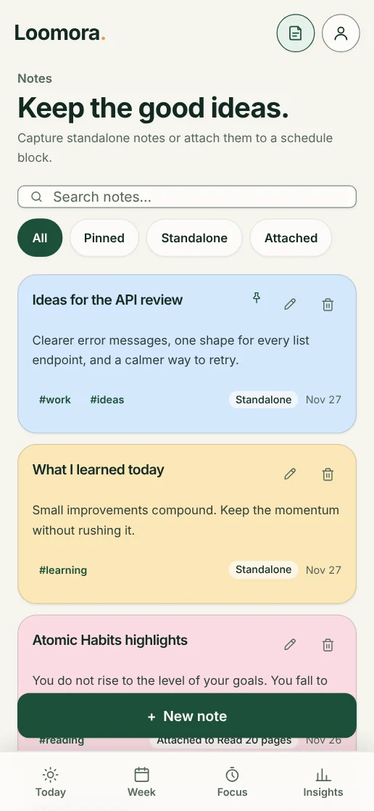</td>
    <td>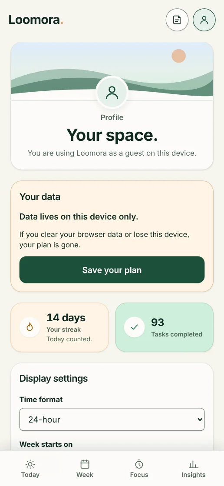</td>
    <td>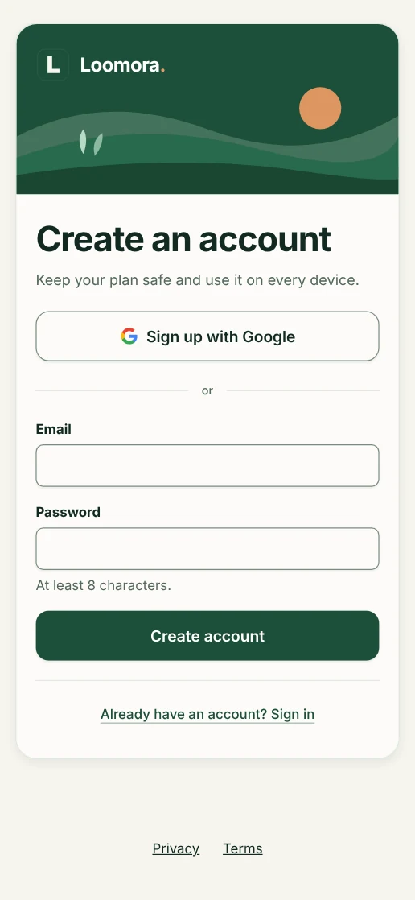</td>
  </tr>
</table>

### On a laptop

Wide screens get a sidebar and two-column layouts instead of a narrow column.

<p align="center">
  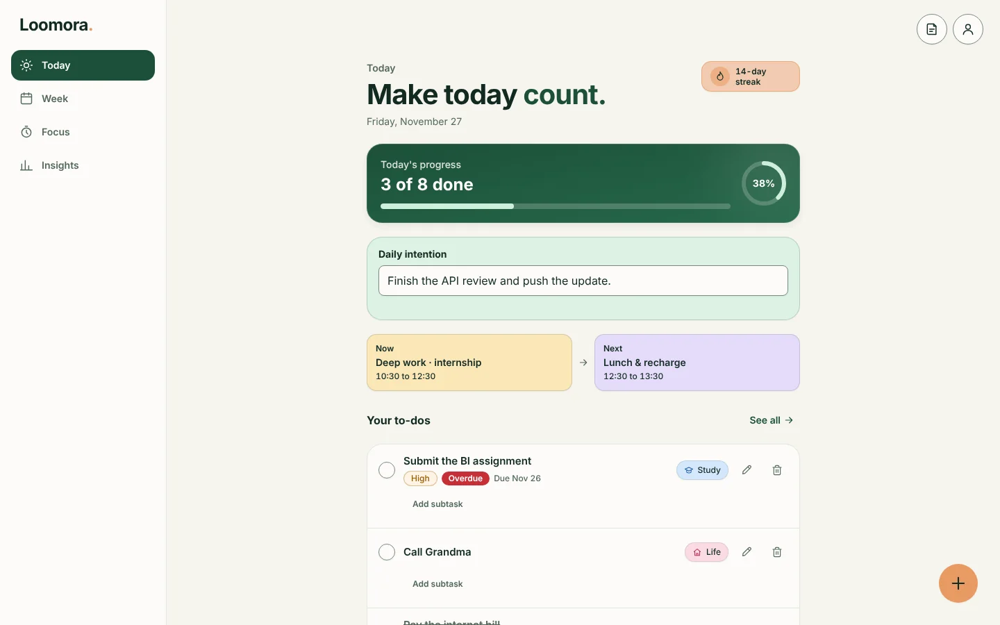
</p>

<table>
  <tr>
    <td>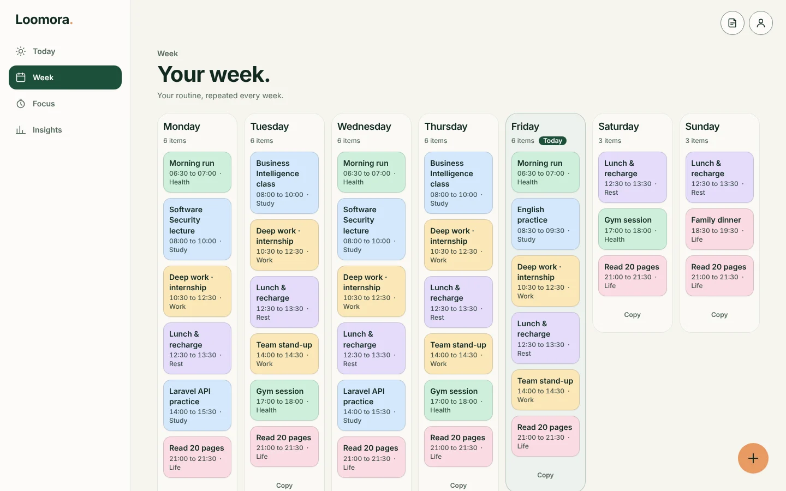</td>
    <td>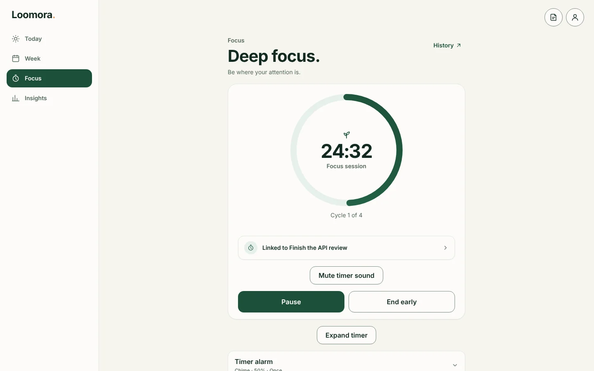</td>
  </tr>
  <tr>
    <td>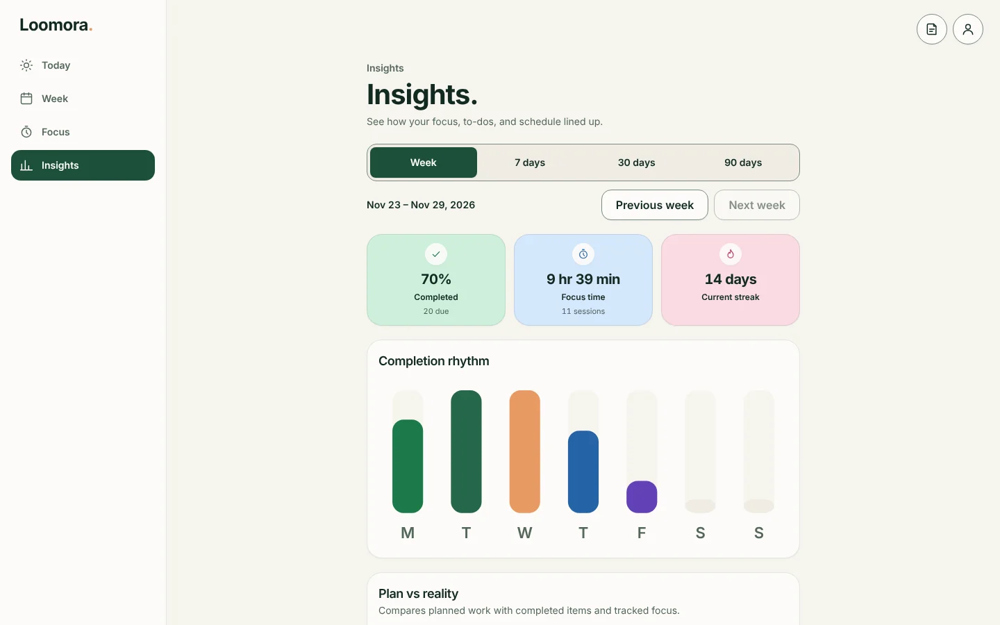</td>
    <td>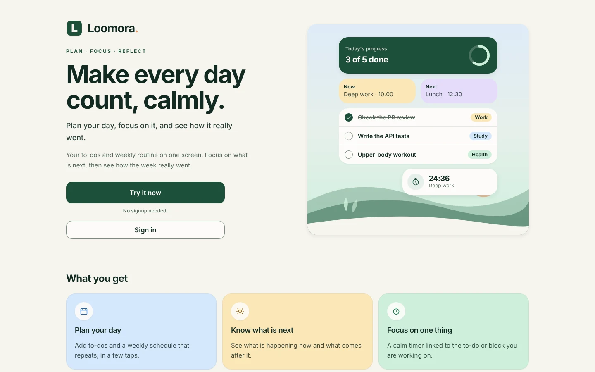</td>
  </tr>
</table>

<sub>Screens use made-up demo data (a student's week) in guest mode. <a href="portfolio/overview.jpg">See all screens on one page</a>.</sub>

## 🎨 Design

**Elemental Edition**: warm ivory `#F7F5EF`, paper `#FCFBF8`, forest ink `#132A23`, deep forest primary `#1D5039`, a restrained peach accent `#E99A63`, and six pastel categories (study, work, health, life, rest, other). The signature motif is green hills under a low peach sun, on the landing page, sign-in, Profile and the Focus ring.

- Mobile-first at 375 px, checked from 320 to 1440 px and with iOS safe areas.
- WCAG 2.2 AA: 4.5:1 text contrast, 44 px touch targets, visible focus, and reduced motion respected everywhere.
- Self-hosted Inter, one theme, and every string through i18n (English now, Khmer later).

## 🧰 Tech stack

| Area | Tools |
|---|---|
| Frontend | React 18, TypeScript (strict), Vite 7, Tailwind CSS 3, Framer Motion |
| State and data | TanStack Query 5, Zustand 5, Dexie 4 (IndexedDB guest mode), React Router 7 |
| PWA | vite-plugin-pwa and Workbox: installable, offline app shell |
| Backend | [Laravel 12 API](https://github.com/danishsary8/loomora_back), PostgreSQL, Sanctum tokens, Google sign-in |
| Quality | Vitest, Testing Library, Playwright, axe-core, ESLint, Prettier, Knip |
| Hosting | Vercel (frontend), Render (API), Neon (PostgreSQL) |

## 📊 By the numbers

| 985 | 714 | 56 | 36 |
|:---:|:---:|:---:|:---:|
| frontend tests | backend tests | API endpoints | end-to-end specs |

## 🚀 Run it locally

```bash
git clone https://github.com/danishsary8/Loomora_front.git
cd Loomora_front
git checkout v2-rebuild
npm ci
npm run dev
```

Open `http://localhost:5173` and press **Try it now**. Guest mode needs no backend. To use accounts, set `VITE_API_URL` (see `.env.example`) to a running [loomora_back](https://github.com/danishsary8/loomora_back) API.

Checks used before every PR:

```bash
npm run lint && npm run knip && npm run format:check && npm run typecheck && npm test && npm run build
```

## 🔗 Links

- **Live app:** https://loomora-craft.vercel.app/
- **API reference:** https://loomora-api.onrender.com/docs
- **Backend repo:** [danishsary8/loomora_back](https://github.com/danishsary8/loomora_back)
- **Full developer README:** [`v2-rebuild/README.md`](https://github.com/danishsary8/Loomora_front/blob/v2-rebuild/README.md)

## 👤 Author

Built by **Sary Danish** ([@danishsary8](https://github.com/danishsary8)) · [Portfolio](https://danish-portfolio-nine.vercel.app/)
