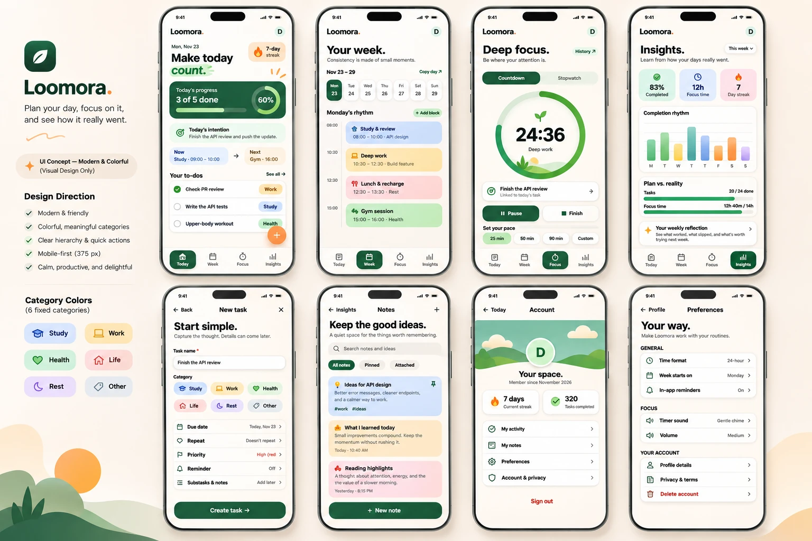
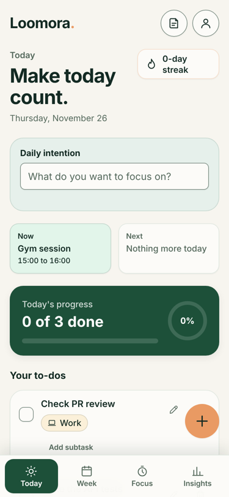
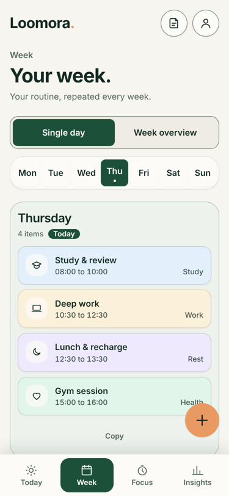
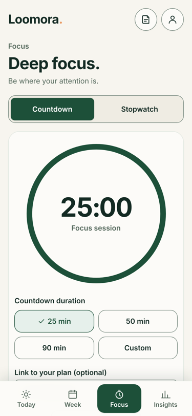
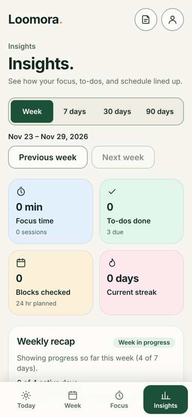
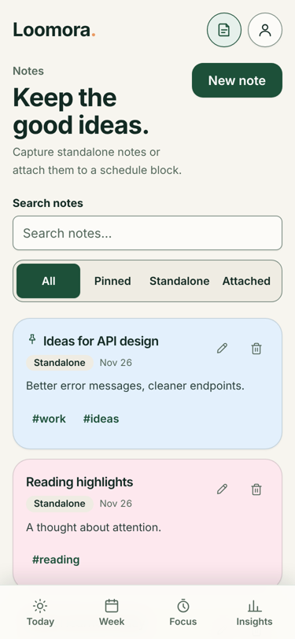
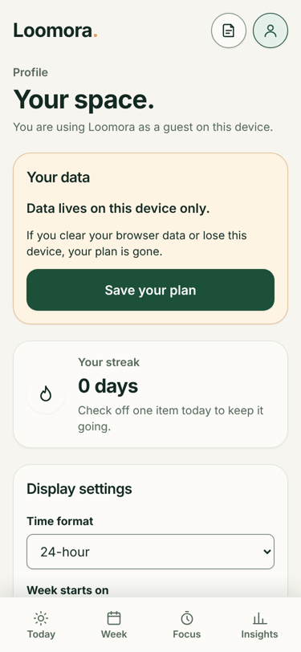
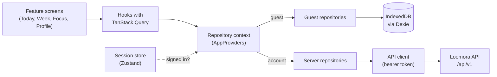

<h1 align="center">Loomora</h1>

<p align="center"><strong>Plan your day, focus on it, and see how it really went.</strong></p>

<p align="center">
  <a href="https://github.com/danishsary8/Loomora_front/actions/workflows/ci.yml"></a>
  
  
  
  
</p>

Loomora is a mobile-first productivity web app (PWA) that keeps a **to-do list** and a **fixed weekly schedule** in one place. Most planners make you choose between a task list and a calendar. Loomora shows what is happening now, what comes next and what still needs doing on a single Today screen. You can start without an account, and your plan moves to an account when you sign up.

This repository is the **frontend**: React, TypeScript, Vite and Tailwind CSS, hosted on Vercel. The API lives in [`loomora_back`](https://github.com/danishsary8/loomora_back) (Laravel 12).

---

## Contents

- [Overview](#overview)
- [UI concept](#ui-concept)
- [Screenshots](#screenshots)
- [Live demo](#live-demo)
- [Tech stack](#tech-stack)
- [Architecture](#architecture)
- [Getting started](#getting-started)
- [Environment variables](#environment-variables)
- [Available scripts](#available-scripts)
- [Testing and quality](#testing-and-quality)
- [Guest and account modes](#guest-and-account-modes)
- [PWA and deployment](#pwa-and-deployment)
- [API integration](#api-integration)
- [Roadmap](#roadmap)
- [Future features](#future-features)
- [Project documentation](#project-documentation)
- [Author](#author)

## Overview

Loomora is built around three pillars, released in stages (see [`docs/02-feature-list.md`](docs/02-feature-list.md)).

| Pillar | Release | Status in this repo |
|---|---|---|
| **Plan** | R1 Today, R2 Repeat, subtasks, reminders | Done |
| **Focus** | R3 Focus | Done |
| **Review** | R4 Insights and Notes | Done |

### Plan (R1 and R2): implemented

- **Today screen:** to-dos due today, undated to-dos, and unfinished earlier to-dos with an **Overdue** badge. Also a progress ring, a check-off stamp animation and a one-line **daily intention**.
- **To-dos:** add, edit, delete with a 5-second undo, and check off. Each to-do has an optional due date, one of six categories, a priority, notes and **subtasks**.
- **Repeating to-dos:** daily, weekly or on custom days.
- **In-app reminders** for to-dos. Push notifications are planned for later.
- **Fixed weekly schedule:** items with a start time, an end time and repeat days. Edits and deletes apply to **only today** or **all repeats**. You can copy a day to other days.
- **Now / Next strip** on Today. Tap it to open the full day.
- **Week view:** a day strip on phones and seven columns on wider screens.
- **Streak:** a day counts when at least one item is checked off.
- **Accounts:** email sign-up with verification, password reset, Google sign-in and a short sign-up survey.
- **Profile:** 12 h / 24 h time format, the first day of the week, feedback, sign out and delete account (including re-confirmation for Google accounts).
- **Error, offline and not-found states**, a service-down banner and an installable, offline-friendly PWA.

### Focus (R3)

- Focus timer with an expanded full-screen view and optional links to to-dos or schedule items.
- **Countdown** with 25, 50 and 90 minute presets or a custom length from 1 to 240 minutes. Each run is four Focus phases with short and long breaks ([DEC-004](docs/DECISIONS.md)).
- **Stopwatch** with laps.
- The timer keeps running when you change pages and is recovered after a reload. Ending early keeps the recorded time.
- **Focus history** by date with Countdown and Stopwatch filters, search, and a full-day Focus total.
- **Timer-end alarm:** three synthesized sounds (Chime, Wood, Bell), a volume setting, and three play modes. Once is the default. Repeat 3× plays three times, and Until I stop repeats until dismissed, up to two minutes. Mute takes precedence, and a Stop alarm control appears while it rings. These settings are saved in this browser for both guests and accounts.
- History filters, search, and delete with undo; guest Focus sessions move to the account on sign-up.

### Review (R4)

- **Insights:** Focus time, to-dos done, schedule blocks checked and the current streak as tinted tiles, plus a weekly recap, Plan vs Reality, a daily breakdown and the streak history, for this week or the last 7, 30 or 90 days.
- **Notes:** standalone or attached to a schedule block (optionally a single date). Search, filters (All, Pinned, Standalone, Attached), **pin to the top**, a **color** from the six category pastels, and up to five **tags** with one-tap tag search. Delete with a 7-day undo.
- **Safe across devices:** note edits carry a revision, so an edit from another device is never silently overwritten; the app offers "Use the latest version" or "Save mine as a new note".

## UI concept

The visual direction is the **Elemental Edition** concept ([DEC-003](docs/DECISIONS.md)): warm ivory, deep forest green, Inter, pastel category colors with icons, and one obvious next action per screen. The iPhone frames are presentation only.

<p align="center">
  
</p>

## Screenshots

The app as built, at 375 px with sample data (UX-018, UX-019, F-R4-06). More screenshots are in [`docs/screenshots/`](docs/screenshots/).

<table>
  <tr>
    <td align="center"><br><sub>Today</sub></td>
    <td align="center"><br><sub>Week</sub></td>
    <td align="center"><br><sub>Focus</sub></td>
  </tr>
  <tr>
    <td align="center"><br><sub>Insights</sub></td>
    <td align="center"><br><sub>Notes</sub></td>
    <td align="center"><br><sub>Profile</sub></td>
  </tr>
</table>

## Live demo

| | URL |
|---|---|
| Frontend (production) | https://loomora-craft.vercel.app |
| API health check | https://loomora-api.onrender.com/api/v1/health |

> [!NOTE]
> Production serves `v2-rebuild`. Automatic Vercel deployments for `v2-rebuild` are turned off in [`vercel.json`](vercel.json) (`git.deploymentEnabled`), so each release is deployed manually from the Vercel dashboard (**Deployments → Create Deployment → `v2-rebuild`**). Remove `"v2-rebuild": false` there to deploy on every merge.
>
> The API runs on Render's free tier, so the first request after a quiet period can take a while.

## Tech stack

| Area | Tools | Role |
|---|---|---|
| UI | [React 18](https://react.dev/), [TypeScript](https://www.typescriptlang.org/) (strict) | Components and type safety |
| Build | [Vite 7](https://vite.dev/) | Dev server and production build |
| Styling | [Tailwind CSS 3](https://tailwindcss.com/), [Inter](https://fontsource.org/fonts/inter) (self-hosted) | Design tokens from `src/styles/tokens.ts` |
| Routing | [React Router 7](https://reactrouter.com/) | Client-side routes with lazy-loaded pages |
| Server state | [TanStack Query 5](https://tanstack.com/query) | Fetching, caching and mutations |
| Client state | [Zustand 5](https://zustand.docs.pmnd.rs/) | Session, service status, PWA update and other small stores |
| Local data | [Dexie 4](https://dexie.org/) (IndexedDB) | Guest mode storage |
| i18n | [i18next](https://www.i18next.com/), react-i18next | All UI text in `src/i18n/en.json` |
| Motion | [Framer Motion](https://motion.dev/) | Sheets and the check-off stamp, with `prefers-reduced-motion` respected |
| PWA | [vite-plugin-pwa](https://vite-pwa-org.netlify.app/), Workbox | Manifest, service worker and offline app shell |
| Unit tests | [Vitest](https://vitest.dev/), Testing Library, jsdom, fake-indexeddb, MSW | Logic and component tests |
| End-to-end | [Playwright](https://playwright.dev/), axe-core | Browser tests and accessibility checks |
| Code quality | ESLint, Prettier, Knip | Linting, formatting and unused-code checks |

## Architecture

### Folder structure

```text
src/
├── app/              router, providers, layouts, PWA update and service worker registration
├── components/
│   ├── ui/           shared primitives: Button, Card, Sheet, Chip, Checkbox, Input, ProgressRing, icons…
│   ├── page/         page heading, standalone page and "Coming soon" layouts
│   └── states/       shared loading, empty and error states
├── features/         one folder per area: today, todos, schedule (incl. week), focus, streak,
│                     reminders, auth, profile, landing, legal, insights, styleguide
├── lib/
│   ├── api/          typed API client, auth/session store, endpoint modules
│   ├── storage/      repository interfaces with guest (Dexie) and server implementations
│   └── time/         time format and week-start preferences
├── i18n/             i18next setup and en.json
├── styles/           design tokens and Tailwind layers
└── test/             Vitest setup
e2e/                  Playwright specs (e2e/staging/ is a separate, approval-gated suite)
docs/                 product, design and API documentation, task queue and progress log
public/               PWA icons
scripts/              icon generation
docs/concept/         the UI concept image
legacy/               the previous app, kept for reference only (ignored by lint and Knip)
```

### Routing

Routes are defined in [`src/app/routes.tsx`](src/app/routes.tsx). Pages are lazy-loaded from [`src/app/pages.ts`](src/app/pages.ts).

| Group | Paths |
|---|---|
| Public | `/` landing, `/privacy`, `/terms`, `/styleguide` |
| App shell (bottom nav on phones, sidebar on wide screens) | `/today`, `/week`, `/focus`, `/insights`, `/notes`, `/profile` |
| Auth | `/sign-in`, `/sign-up`, `/sign-up/survey` (signed in only), `/forgot-password`, `/reset-password`, `/verify-email`, `/auth/google/callback` |
| Account deletion | `/auth/google/deletion/callback` |
| Fallback | `*` not-found page |

### Data flow

The guest and account modes use the **same data shapes and the same UI code**. A storage adapter hides where the data lives ([`docs/10-tech-and-structure.md`](docs/10-tech-and-structure.md), A8-5).



- **Repositories:** `TodoRepository`, `ScheduleRepository`, `StreakRepository`, `FocusSessionRepository` and `NoteRepository` each have a guest (Dexie) and a server implementation in [`src/lib/storage/`](src/lib/storage/). [`AppProviders`](src/app/AppProviders.tsx) chooses which one to use from the session state.
- **API client:** [`src/lib/api/`](src/lib/api/) builds requests against `VITE_API_URL`. It attaches the Sanctum bearer token and signs the user out after a `401`. It also marks the service as down when the API cannot be reached, which shows a banner.
- **Shared rules:** Today-list rules, schedule occurrences, Now/Next and the streak are pure functions with unit tests. The client sends its local date and time zone so that "today" is correct for every user.

## Getting started

### Prerequisites

- **Node.js 22 or newer** (`engines` in `package.json`; CI uses Node 22)
- npm (the repository has a `package-lock.json`)
- Optional: a local [`loomora_back`](https://github.com/danishsary8/loomora_back) API. Guest mode works without any backend.

### Install and run

```bash
git clone https://github.com/danishsary8/Loomora_front.git
cd Loomora_front
git checkout v2-rebuild
npm ci
cp .env.example .env   # optional, see Environment variables
npm run dev
```

Vite prints the local URL (by default `http://localhost:5173`). Choose **Try it now** to use guest mode right away.

## Environment variables

[`.env.example`](.env.example) lists the only variable the frontend reads:

| Variable | Required | Purpose |
|---|---|---|
| `VITE_API_URL` | No | Base URL of the Loomora API, **including** `/api/v1`. If empty, the app uses `http://localhost:8000/api/v1`. |

Variables prefixed with `VITE_` are built into the client bundle, so never put secrets in them. Do not commit `.env` files.

The production Content Security Policy in [`vercel.json`](vercel.json) allows API connections only to `'self'` and `https://loomora-api.onrender.com`. Pointing a Vercel deployment at another API origin also needs a matching `connect-src` change.

## Available scripts

| Command | What it does |
|---|---|
| `npm run dev` | Start the Vite dev server |
| `npm run build` | Type-check (`tsc -b`) and build for production into `dist/` |
| `npm run preview` | Serve the production build locally |
| `npm run lint` | ESLint |
| `npm run typecheck` | TypeScript project build check (`tsc -b`) |
| `npm run knip` | Find unused files, exports and dependencies |
| `npm test` | Run the Vitest suite once |
| `npm run test:watch` | Run Vitest in watch mode |
| `npm run format` | Format the repository with Prettier |
| `npm run format:check` | Check formatting without writing |
| `npm run e2e` | Run the Playwright end-to-end suite |
| `npm run icons` | Regenerate the PWA icons in `public/` from `scripts/` |

## Testing and quality

```bash
npm run lint
npm run knip
npm run format:check
npm run typecheck
npm test
npm run build
```

**Unit and component tests (Vitest).** Tests sit next to the code as `src/**/*.test.ts(x)`. They run in jsdom, with `fake-indexeddb` for Dexie and MSW for API calls.

**End-to-end tests (Playwright).** `npm run e2e` builds the app and serves it with `vite preview`, so no dev server is needed. API calls go to route fixtures on a reserved `.invalid` origin and never reach a deployed API. The config defines six projects: Chromium, Firefox and WebKit, each at 375 px and 1280 px.

```bash
npx playwright install chromium         # once
npm run e2e -- --project=phone-375      # what CI runs
npm run e2e -- e2e/week.spec.ts         # a single spec
npx playwright install                  # once, all browsers, before a full `npm run e2e`
```

The suite includes accessibility checks with axe (`e2e/a11y.spec.ts`), security headers, SPA routing, PWA and offline behavior, cross-tab sessions and Focus timer recovery. `e2e/staging/` is a separate suite for an approved staging pair (`playwright.staging.config.ts`). The default config skips it.

**Continuous integration.** [`.github/workflows/ci.yml`](.github/workflows/ci.yml) runs on every pull request and on pushes to `main` and `v2-rebuild`. It has two jobs:

1. **Lint, typecheck, test, build:** `npm ci`, lint, Knip, format check, typecheck, Vitest and build.
2. **End-to-end (375 px):** Playwright `phone-375` on Chromium. Traces are uploaded when a test fails.

## Guest and account modes

| | Guest | Account |
|---|---|---|
| Where data lives | IndexedDB on this device (Dexie) | Loomora API (PostgreSQL) |
| Sign-up needed | No | Email and password, or Google |
| Works offline | Yes, after the first visit | Shows offline and service-down states |
| Sync across devices | No | Yes |

- **Guest mode** stores everything in the browser. The Profile screen says so: clearing browser data or losing the device removes the plan.
- **Save your plan:** when a guest signs up or signs in, the app offers to import their to-dos (with subtasks and repeats), schedule items, exceptions, check-ins and daily intentions. Every row keeps its client-generated UUID, so a retried import does not create duplicates. Large plans are sent in several calls that stay under the API limits. Local data is removed only after every call succeeds and only where it still matches what was sent. If a call fails, the local plan is kept for a retry.
- Guest **Focus sessions** are kept separately and are not part of this import.
- **Sessions** use a bearer token kept in `localStorage`. Sign-in and sign-out are synchronized across open tabs.

## PWA and deployment

**PWA** (configured in [`vite.config.ts`](vite.config.ts)):

- Web app manifest: name *Loomora*, `start_url` `/today`, standalone display, portrait orientation, ivory `#F7F5EF` theme, and regular and maskable icons.
- A Workbox service worker precaches the app shell (JS, CSS, HTML, fonts and icons), so the app opens offline after one visit. It also takes control of the first open tab.
- Updates use `registerType: 'prompt'`. A new version waits until the user accepts it, so active work is never reloaded silently.
- Navigation fallback to `index.html`, except for `/api`, `/assets`, the service worker files and the Google deletion callback.

**Vercel** (configured in [`vercel.json`](vercel.json)):

- Vite framework preset, build command `npm run build`, output directory `dist`.
- SPA rewrite to `/index.html` for every path except `/api`, `/assets`, `sw.js`, the manifest and Workbox files.
- Security headers on every response: a strict Content Security Policy, `X-Content-Type-Options`, `X-Frame-Options: DENY`, `Referrer-Policy`, HSTS and `Permissions-Policy`. The Google deletion callback is also `no-store` and `no-referrer`. `sw.js` is always revalidated.
- `git.deploymentEnabled` turns off automatic Vercel deployments for `v2-rebuild` and for a list of feature branches, so production is deployed manually (see [Live demo](#live-demo)).

## API integration

- **Backend repository:** [danishsary8/loomora_back](https://github.com/danishsary8/loomora_back) (Laravel 12, PHP 8.3, PostgreSQL, Sanctum)
- **API contract:** [`docs/openapi.yaml`](docs/openapi.yaml) (OpenAPI 3.1). This is a copy of the backend's [`docs/openapi.yaml`](https://github.com/danishsary8/loomora_back/blob/v2-rebuild/docs/openapi.yaml). The design notes are in [`docs/09-api-design.md`](docs/09-api-design.md).
- Base path `/api/v1`, JSON only. Authentication uses `Authorization: Bearer <token>`.
- The frontend has typed modules for auth, to-dos, schedule, account data (import, streak, feedback, delete account), Focus sessions and health in [`src/lib/api/`](src/lib/api/).

The API has no hosted documentation page. Read the OpenAPI file directly or load it into any OpenAPI viewer.

## Roadmap

| Stage | Status |
|---|---|
| **R1 Today**: to-dos, weekly schedule, Now/Next, Week, guest mode, accounts, streak, PWA | Done |
| **R2 Repeat, subtasks, reminders**: plus priority, notes on to-dos, daily intention, time preferences | Done |
| **R3 Focus**: countdown cycles, stopwatch with laps, history with filters, search and delete, alarm settings, full-screen view | Done |
| **R4 Review**: Insights, weekly recap, Plan vs Reality, streak history, Notes with search, pin, color and tags | Done |
| **Elemental concept v3** (UX-018, UX-019) | Done |
| **Release**: production deploy, legal details (QA-004), staging test pass (QA-009), open questions Q23 and Q25 | In progress, owner actions |

The task queue is [`docs/TASKS.md`](docs/TASKS.md), and each session's notes are in [`docs/PROGRESS.md`](docs/PROGRESS.md).

## Future features

Push notifications, the Today insight sentence, achievements, avatars and a custom alarm sound are marked **Later** in [`docs/02-feature-list.md`](docs/02-feature-list.md); Khmer is planned in the project rules, and quick add and data export are earlier roadmap ideas. None is started, and each needs owner approval before work begins.

| Feature | What it adds |
|---|---|
| **Khmer language** | A second UI language. All text already goes through i18next, so this is translation plus Khmer font pairing. |
| **Push notifications** | Reminders that arrive when the app is closed (today's reminders are in-app only). |
| **Today insight sentence** | One plain sentence on Today about how the week is going, from the Insights data. |
| **Achievements** | Server-side milestones, such as streak lengths and Focus hours. |
| **Avatar** | A profile picture instead of the initial in the top bar. |
| **Custom alarm sound** | Your own sound for the Focus timer alarm. |
| **Quick add by typing** | Type "Gym tomorrow 6pm" to create a to-do or schedule item. |
| **Data export** | Download your plan, Focus history and notes. |

## Project documentation

| Document | Contents |
|---|---|
| [Product brief](docs/01-product-brief.md) | The problem, audience and goals |
| [Feature list](docs/02-feature-list.md) | Features by release and priority |
| [User stories (R1)](docs/03-user-stories-r1.md) | R1 user stories |
| [User flows](docs/04-user-flows.md) | Key flows step by step |
| [Screen map](docs/05-screen-map.md) | Screens and routes |
| [Roadmap and automation](docs/06-roadmap-and-automation.md) | Phases and who builds them |
| [Project decisions](docs/07-project-decisions.md) | Decisions made before coding |
| [Data model](docs/08-data-model.md) | Entities and business rules |
| [API design](docs/09-api-design.md) | API design notes |
| [Tech and structure](docs/10-tech-and-structure.md) | Stack and architecture decisions |
| [Decisions log](docs/DECISIONS.md) | Design and runtime decisions (DEC-001 to DEC-004) |
| [UI concept](docs/concept/loomora-concept-v3.webp) | Elemental Edition concept image (v3) |
| [Security findings](docs/SECURITY-FINDINGS.md) | Security review notes |

Contributor rules are in [`CLAUDE.md`](CLAUDE.md) and [`AGENTS.md`](AGENTS.md).

## Author

Built by **Sary Danish** ([@danishsary8](https://github.com/danishsary8)) · [Portfolio](https://danish-portfolio-nine.vercel.app/)

- Frontend: [danishsary8/Loomora_front](https://github.com/danishsary8/Loomora_front)
- Backend: [danishsary8/loomora_back](https://github.com/danishsary8/loomora_back)

No license file is included in this repository.
