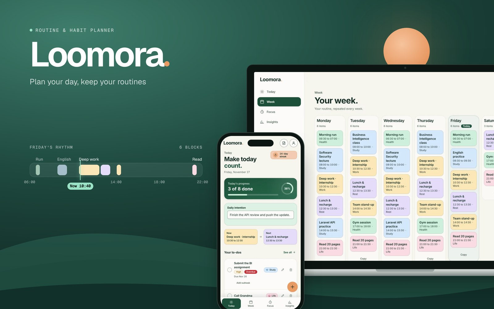
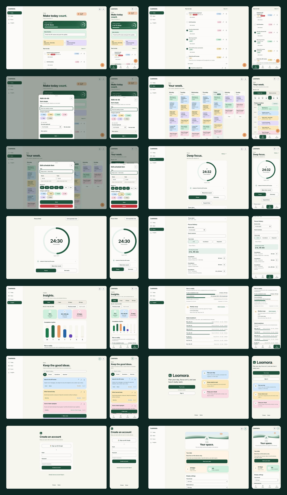

# Portfolio kit: Loomora

Everything needed to add Loomora to the portfolio (Danish_portfolio), in the same shape as
the Bookly case study. Captured from the real app with demo data on 27 Nov 2026.

## What's here

| Path | What it is | Size |
| --- | --- | --- |
| `cover/card.webp` | Project card cover (16:10), with title and one line | 3200×2000 |
| `cover/banner.webp` | Wide banner for the top of the case study (2.4:1), no title | 3840×1600 |
| `cover/*.jpg` | Same covers at half size, for LinkedIn, README or slides | |
| `cover/cover.source.html` | Source of both covers, if a change is ever needed | |
| `screens/*.webp` | 14 screens, each on laptop and phone | laptop 1440×900, phone 516×1118 |
| `loomora.portfolio.ts` | Ready-to-paste portfolio entry: pitch, problem, what I built, screens, numbers, future plan | |
| `overview.jpg` | All 14 screens on one page, for a quick look | |

The sizes match the Bookly screenshots already in the portfolio, so the case studies line up.

## The cover

The cover has its own look instead of reusing the Bookly and Diabetes layout. It keeps the
portfolio's Loomora green from `ProjectCover.tsx` (`#3f7d6b → #1f4a3f → #0f2722`, mint
`#9be3c6` dot) and the Geist font, and takes everything else from the app:

- The wordmark with the app's round orange dot.
- The layered hills and low sun from the Profile screen, redrawn in the cover's greens.
- A real laptop (Week view) and a phone (Today).
- **The app detail:** a day ribbon. Friday's real demo schedule on an hour ruler, in the
  app's category colours, with a mint "Now 10:40" line. That is the same moment the Today
  screen shows in its Now / Next card.

To re-render: open `cover.source.html?mode=card` at 1600×1000 or `?mode=banner` at 1920×800
and take a screenshot at 2×.

## The story (also in `loomora.portfolio.ts`)

**Pitch.** Your to-dos and your weekly routine on one screen. Focus on what's next, then see
how the week really went.

**The problem.** Most planners make you choose between a task list and a calendar. Your
routine lives in one app, your to-dos in another, and nothing tells you how the week
actually went.

**What I built.** One calm app for the day: to-dos and a repeating schedule on a single
Today screen, a focus timer, notes, and insights that compare the plan with what really
happened.

**Numbers** (checked on 27 Nov 2026):

| Number | Where it comes from |
| --- | --- |
| 981 frontend tests | `npm test` in this repo (`v2-rebuild`, 2531e7b): 85 files, all passing |
| 714 backend tests | GitHub Actions CI run 171 of `loomora_back` (`v2-rebuild`, 9a14b78), on PostgreSQL 16, all passing |
| 56 API endpoints | 56 routes in `routes/api.php`, matching the 56 operations in `docs/openapi.yaml` |
| 36 end-to-end specs | `e2e/*.spec.ts` in this repo (the staging suite is extra) |

**Future development plan** (from the app's own roadmap; none of it is started yet)
- Khmer language
- Push reminders when the app is closed
- Quick add by typing, like "Gym tomorrow 6pm"
- Export your plan, focus history and notes

**Facts row:** Own project, full-stack · Live on Vercel · No sign-up needed · Offline · installable.

## Screens

Every screen has a laptop file (`name.webp`) and a phone file (`m-name.webp`).

| Group | Screen | File |
| --- | --- | --- |
| Plan | Today: progress, intention, now and next | `today` |
| Plan | To-dos with overdue, subtasks and repeats | `today-todos` |
| Plan | Add a to-do sheet | `new-task` |
| Plan | Week: the fixed routine | `week` |
| Plan | Edit a schedule block | `edit-block` |
| Focus | Focus timer running, linked to a to-do | `focus` |
| Focus | Full-screen timer | `focus-expanded` |
| Focus | Focus history for one day | `focus-history` |
| Review | Insights for the week | `insights` |
| Review | Plan vs reality, weekly recap, daily breakdown | `insights-review` |
| Review | Notes | `notes` |
| Account | Landing page | `landing` |
| Account | Sign up (email or Google) | `sign-up` |
| Account | Profile | `profile` |

## Adding it to the portfolio

1. Copy `screens/*.webp` into `src/assets/projects/loomora/` and the covers next to the other covers.
2. Add the `loomora` image lookup to `src/lib/assets.ts` (the exact lines are at the top of
   `loomora.portfolio.ts`), and point `ASSETS.projects.loomora.src` at `loomora("today")`.
3. In `src/content/portfolio.ts`, replace the current `loomora` entry with the one in
   `loomora.portfolio.ts`, and map each screen name through the lookup.
4. Widen `CaseStudy.screens[].group` to include `"Plan" | "Focus" | "Review" | "Account"`.
5. The "How I built it" blocks (`steps`, `practices`, `challenges`, `lessons`) are empty on
   purpose. Hide a block when its list is empty, so no empty headings show.
6. `ProjectCover` draws real devices only for `id === "bookly"` and a drawn `LoomoraPreview`
   for Loomora. Either use `cover/card.webp` as the Loomora cover image, or add the same
   laptop + phone branch for `loomora` with `week` and `m-today`.
7. Update the Jarvis chat facts in `src/data/jarvisKnowledge.js` to match. It still links the
   old Render app and has no Focus, Insights or Notes.

## Notes

- **Demo data only.** The screens come from the app in guest mode, run locally (`npm run dev`)
  with a made-up student's week (classes, internship deep work, gym, reading) seeded into the
  browser's own guest database. No account was used and no real user data was involved. The
  clock was fixed to Friday 27 Nov 2026, 10:40 (Phnom Penh), so Now / Next and the timer are
  stable.
- The guest "Save your plan" prompt was snoozed for the screenshots. The orange **+** button
  is the app's own "Add a to-do" button, not a chat widget, so it stays in.
- The Profile screen is the guest version ("Your space", data on this device). The signed-in
  version needs a running API.
- **Things to confirm:**
  - The current portfolio links `https://daycraft-vnid.onrender.com/`. This entry uses
    `https://loomora-craft.vercel.app/` from the app's README, and hosting
    "Vercel · Render · Neon" from the backend README.
  - The stack now includes **TypeScript**, because the frontend is strict TypeScript.
    Portfolio rules keep TypeScript out of claims unless you say so, so remove it if you prefer.
  - **Role.** The entry says "Own project, full-stack" and "I built the React frontend and
    the Laravel API". It doesn't say "solo": the git history also has commits from
    `nishthegreatest` and from Claude Code (AI coding agent). If `nishthegreatest` is your
    second account, "Solo" is fine. You may also want to mention that you worked with AI
    coding agents.
